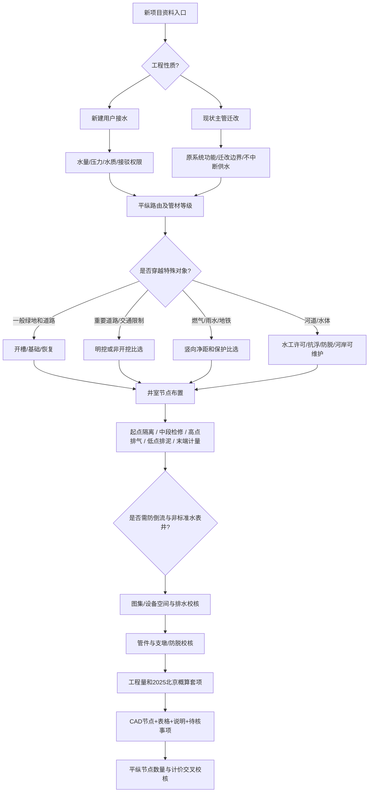

# CAP 给水管线快速设计导则 / CAP Water Pipeline Design Guide

版本 `2.2.0`（2026-11-17）。适用于水源接入、室外给水、城市道路给水迁改、河道和高风险交叉穿越、工程量与概算。定位为**可迭代的设计经验决策系统**，不是替代规范或注册设计人员的成套自动出图程序。

## 决策树总图



## 文件树

```text
SKILL.md                               总执行规则
rules/
  01_场景决策树.md                       总场景分支，何时主动提问
  02_节点井室与间距.md                   节点功能、阀门间距历史统计
  03_管材接口与防护.md                   球墨、复合钢、套管、热水及保温
  04_交叉穿越及施工.md                   过路/燃气/地铁/雨水/河道/顶管
  05_计量井及图集.md                     水表、过滤、倒流、07MS101等
  06_概算工程量与套项.md                 工程量、土方、北京2025口径
  07_CAD出图和说明.md                    平纵节点图层、说明书表达
cases/
  历史项目证据与版本冲突.md               每个既有项目与版本来源
checklists/
  初设概算审核门槛.md                    可交付前质量检查
  证据状态与新增规则模板.md               新经验入库格式
templates/
  新项目关键询问.md                      条件触发的问题清单
archive/
  CAP_给水管线节点布置与概算工程量_SKILL_V1.0.md  原文封存
CHANGELOG.md                             版本演变
```

## 规则优先级与证据状态
| 等级 | 意思 | 是否自动复用 |
|---|---|---|
| `[N]` | 经核验的现行规范/法规/图集适用条款 | 适用条件满足时，先行约束 |
| `[P]` | 本项目已确认的工程条件、权属要求、批复 | 仅本项目 |
| `[H]` | 历史实际采用的用户习惯/方案 | 作候选方案，不是强制值 |
| `[E]` | 概算阶段推定的配置或数量 | 明确暂估、待深化 |
| `[Q]` | 未找到实物/几何/勘察/条文证据 | 提问或列待核 |

默认先输出分段设计原则、建议节点清单和假设，再生成CAD。必须让图、清单和总价有对应关系。新版默认保留旧版作为审计基线。**规则本身不应囊括具体工程原始保密图纸。**

## 资料与授权边界

源工程文件和项目级细节保存在内部资料库，不在公开仓库披露。公开规则以经授权的匿名经验总结和现行规范复核为依据。

## V2.1新增入口：默认平面布井→节点大样→物料数量

第一读 `rules/08_平面节点大样默认优先匹配.md` ；第二读 `cases/README.md`；第三使用 `templates/节点大样与概算BOM模板.md`生成新项目工程量。原图大量使用代理实体，尚不能机械还原成可编辑标准节点，不得伪装几何校核完成。

## V2.2 快速读图原则

- 一般长距离配水管先约300～400m试布检修分段，逐段按规范、运维和道路环境优化。
- 原则优先明杆软密封闸阀（例如Z41X-16Q），不要与暗杆Z45X-16Q混写。
- 过路下挖回升时，根据纵断检查两侧隔断、低点排泥和局部高点排气；简单位移且管线纵断平顺时不得机械多设井。
- 多管共井根据外包络总宽度初选图集井室，再核设备、净空和结构，不可直接把单管定型井套成双管承载结构。
- **公开发布边界**：本代码库的规则、模板可以公开；历史项目原版、含精确路由/内部工程资料的案例暂不随公开仓库发布。
